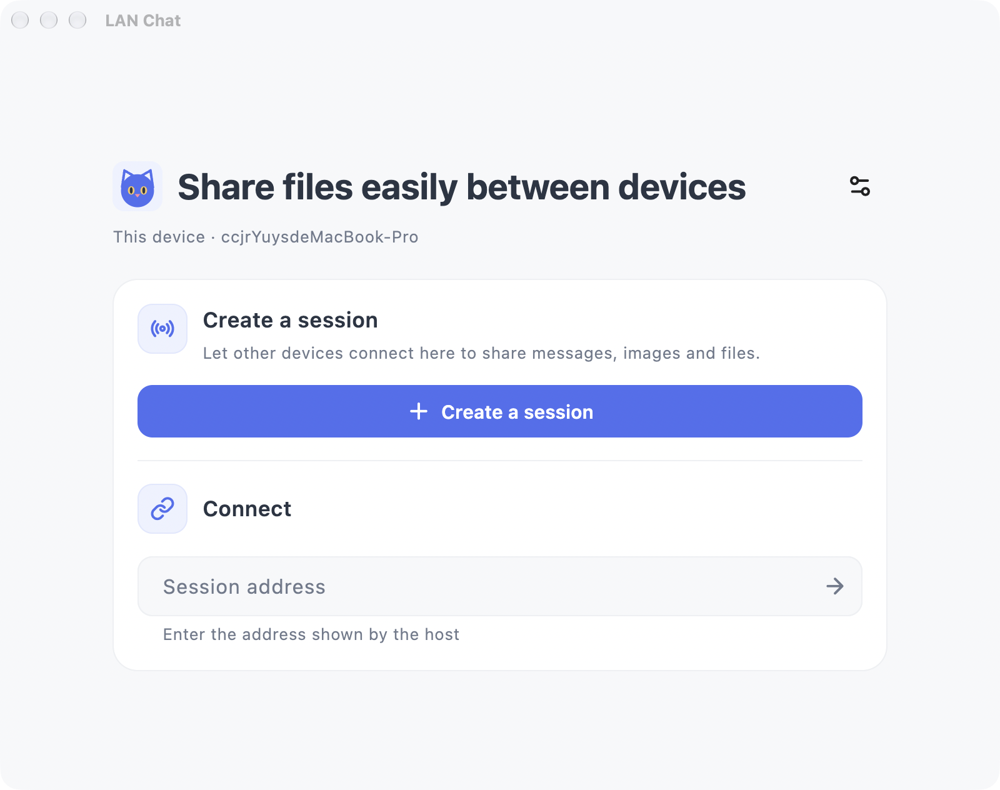
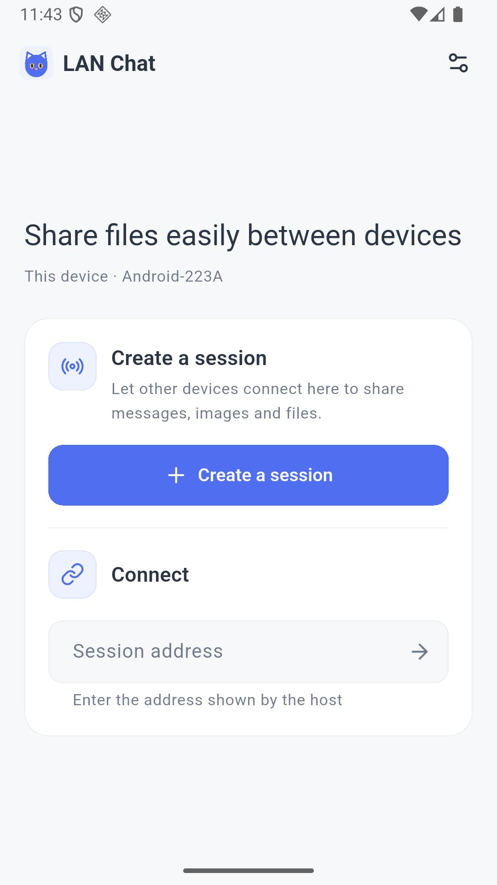

# LAN Chat

[中文](README.md) | English

Share text, images, and files between Android devices, Macs, and browsers on the same Wi-Fi network or personal hotspot. No account or external server is required.

One device hosts a session; others join using its address or QR code. Chat history and received files are stored on the host.

## Preview

## Get started

1. Connect the devices to the same local network, or connect them to the host's hotspot.
2. Open the app on an Android device or Mac and select **Create session**.
3. In the chat, select the QR code icon in the upper right to show the connection address and QR code.
4. On another device, enter the address on the app's home screen, scan the QR code, or open the address in a browser.
5. Once connected, send messages and files.

Each new session starts with an empty chat. Previous history is archived locally on the host, and previously received files are kept.

## Invite and connect

The host can use the QR code button in the chat header to show connection information and the **Require approval for new devices** switch. Select the button again to hide the information.

When approval is enabled, new devices must wait for the host to accept them. When it is disabled, devices on the network that can reach the address can join directly. A device already approved during the current session can reconnect without another approval.

After switching networks or enabling a hotspot, select **Refresh addresses** in the connection information. Use the address and port shown on the screen.

## Messages and files

- Type a message or select the attachment button to choose files.
- Select a received file to open it, or use its share button to send it to another app.
- In a browser, you can also drag in files or paste screenshots. Press Enter to send text or Shift+Enter for a new line.
- If a transfer is interrupted, send the file again.
- The device button in the chat header lists connected devices.

When the host returns to the home screen, the session ends. If other devices are connected, the host is asked to confirm first. A client disconnects when it returns home.

## Settings

Use the settings button on the home screen to change the device name, theme, or language. Theme and language follow the system by default. A changed device name takes effect the next time you create or join a session.

## Troubleshooting

**Can't connect?**

Make sure the devices are on the same Wi-Fi network or hotspot, and use the complete current address and port shown by the host. Refresh the address after changing networks. Some public or corporate networks isolate devices; try a personal hotspot instead.

**Why did the session disconnect when the host went to the background?**

The operating system may suspend or stop background apps. Keep the host app in the foreground during transfers.

**Why isn't my previous chat in the new session?**

Every new session starts empty. Previous history remains archived locally on the host and is not automatically displayed in the new session. Received files remain on the host.

**Is the connection encrypted?**

The connection uses plain HTTP and WebSocket and does not provide end-to-end encryption. Use it on a trusted local network. Join approval controls access to the session; it does not encrypt traffic.
