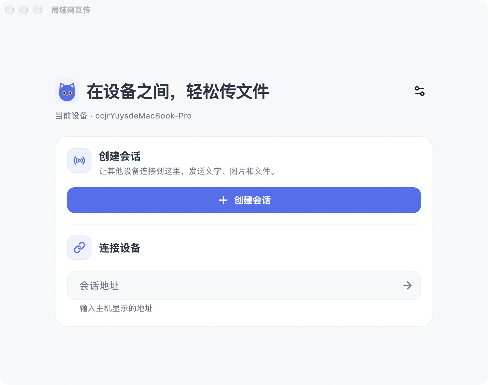
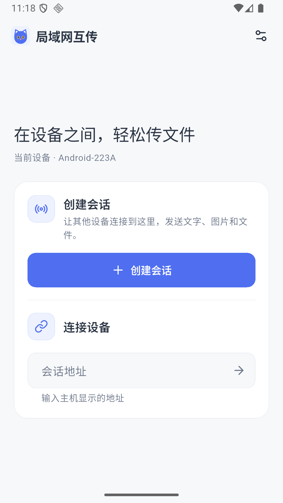

# 局域网互传

中文 | [English](README.en.md)

在同一个 Wi-Fi 或手机热点内，在 Android 设备、Mac、Windows 电脑和浏览器之间互传文字、图片和文件。无需账号，也无需经过外部服务器。

由一台设备创建会话，其他设备通过地址或二维码加入。聊天记录和接收的文件保存在主机设备上。

## 界面预览

## 开始使用

1. 将设备连接到同一个局域网，或让其他设备连接主机开启的热点。
2. 在 Android、Mac 或 Windows 上打开应用，点击「创建会话」。
3. 在聊天页点击右上角的二维码图标，查看连接地址和二维码。
4. 其他设备在应用首页输入该地址并连接；也可以扫描二维码，或在浏览器中输入地址加入。
5. 连接后即可发送文字和文件。

每次创建的都是新会话，不会显示上一次的聊天记录。旧记录会归档在主机本地，之前接收的文件也会保留。

## 邀请与连接

主机可以在聊天页右上角打开连接信息，查看二维码、连接地址以及「新设备加入需要确认」开关。再次点击二维码图标可关闭连接信息。

打开加入确认后，新设备需要等待主机同意；关闭后，同一网络内能够访问该地址的设备可直接加入。同一会话中已获同意的设备断线重连时，无需重复确认。

切换网络或开启热点后，可在连接信息中点击「刷新地址」。实际地址和端口以页面显示为准。

## 消息与文件

- 在输入框中发送文字，或点击附件按钮选择文件。
- 点击收到的文件可打开；需要时可使用文件旁的分享按钮交给其他应用。
- 在浏览器中还可以拖入文件或粘贴截图。Enter 发送文字，Shift+Enter 换行。
- 文件传输中断后需要重新发送。
- 聊天页顶部的设备图标可查看当前在线设备。

主机返回首页时会结束会话；如果还有其他设备在线，应用会先询问是否结束。客户端返回首页会断开当前连接。

## 设置

在首页右上角的设置中，可以修改设备名称、主题和语言。主题与语言默认跟随系统；设备名称修改后，在下次创建或加入会话时生效。

## 常见问题

**连接不上怎么办？**

确认设备连接到同一 Wi-Fi 或热点，使用主机连接信息中当前显示的完整地址和端口。切换网络后先刷新地址。某些公共或企业 Wi-Fi 会隔离设备，可尝试使用个人热点。

Windows 作为主机时，首次创建会话会弹出防火墙提示，需允许「专用网络」访问；若当前网络被识别为「公用网络」，请在系统设置中改为专用网络，或在防火墙中允许本应用。

**主机切到后台后为什么断开了？**

系统可能暂停或回收后台应用。传输期间尽量让主机保持在前台。

**新会话为什么没有之前的消息？**

每次创建会话都会从空记录开始。旧聊天记录归档在主机本地，不会自动显示在新会话里；已接收文件仍保存在主机上。

**使用时需要注意什么？**

连接使用明文 HTTP 和 WebSocket，不提供端到端加密。请在可信的局域网中使用；加入确认用于控制设备进入会话，不能加密网络流量。
